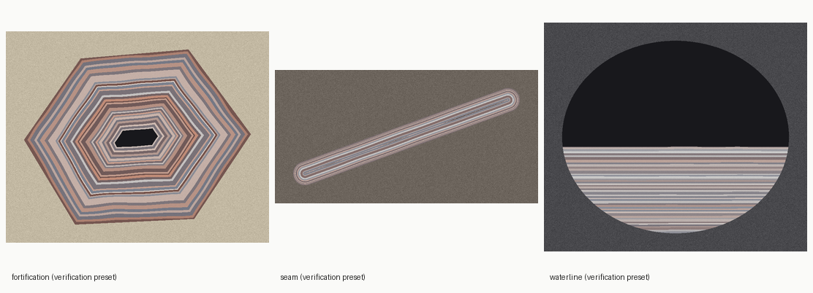

# agatesim

[](https://github.com/lbillings-pixel/agatesim/actions/workflows/ci.yml)

**agatesim** simulates how natural agate forms inside its host rock, at the scale of
a single nodule or seam. By changing environmental and geological conditions over
time, it aims to reproduce each of the classic agate forms (fortification,
waterline, botryoidal, moss, shadow, iris and more) and to show which conditions,
and which proposed formation mechanisms, can produce them.

> **Status: M1 (first procedural models).** See the [roadmap](docs/roadmap.md).



## What it reproduces so far

Each target form is a rung on the [archetype ladder](docs/archetypes.md). A form
counts as reproduced only when a committed preset passes all of its quantitative
criteria in CI. Each criterion is also tested against results that *lack* its
form, so it can't pass everything. Procedural and mechanistic models are tracked
separately: reproducing a form procedurally says nothing about how it forms in
nature ([ADR 0005](docs/adr/0005-verification-tiers-and-parameter-natures.md)).

| Form | Procedural | Mechanistic |
|---|---|---|
| Fortification | ✅ verified | pending |
| Vein / seam | ✅ verified | pending |
| Waterline | ✅ verified | pending |
| Combined, quartz-centre geode, botryoidal, eye, tube, moss, plume, shadow, iris | pending | pending |

## Approach

- **2D cross-sections first**, with 3D later.
- **Procedural models first** for fast, controllable results. Mechanistic physics
  (reaction–diffusion, phase-field, settling) comes later, behind the same
  interface ([ADR 0003](docs/adr/0003-model-architecture.md)).
- **Competing formation hypotheses are separate, swappable mechanisms**, because
  the science is unsettled ([science notes](docs/science/mechanisms.md)).
- **Every run is reproducible** from its config, seed and code version.
- **Previews show the same agate as full runs.** Geometry is exact and noise is
  defined in world coordinates, not pixels.

## Getting started

Requires [uv](https://docs.astral.sh/uv/).

```sh
uv sync                                   # create the environment
uv run agatesim presets                   # shipped run presets
uv run agatesim cavities                  # preset cavity shapes
uv run agatesim run fortification         # full run -> runs/<run-id>/
uv run agatesim run waterline --preview   # quick 256 px preview
uv run agatesim run my-config.toml        # your own configuration
uv run agatesim archetypes                # the archetype ladder and its status
```

Each run directory contains `config.toml` (reproduces the run exactly),
`metadata.json` (code version, seed, library versions), `fields.zarr` (material
fields), `slab.png` (rendered slab) and `metrics.json` (archetype criteria).

## Development

```sh
uv run pytest                             # tests
uv run ruff check; uv run ruff format     # lint and format
uv run pyright                            # strict type checking
uv run pre-commit install                 # run checks on every commit
uv run python scripts/make_gallery.py     # regenerate docs/images
```

## Project layout

```
src/agatesim/
  archetypes/        archetype ladder (registry.toml): criteria and thresholds
  presets/           shipped run configs; one per verified archetype
  models/            formation models (procedural fortification, waterline)
  criteria/          measurements that judge results against the ladder
  geometry.py        cavity shapes, exact masks and wall distances
  config.py          run configuration (TOML)
  simulate.py        run a configuration
  render.py          slab rendering (placeholder until the optical renderer, M6)
  runs.py            run records
tests/               pytest suite, including negative controls for every criterion
docs/
  adr/               architecture decision records
  science/           literature notes and model rationale
  archetypes.md      generated from the registry; do not edit by hand
  images/            generated by scripts/make_gallery.py
references/          literature catalogue with checking level and licences
```

## License

[MIT](LICENSE). Literature and reference material keep their own licences; see
[references/](references/README.md).
